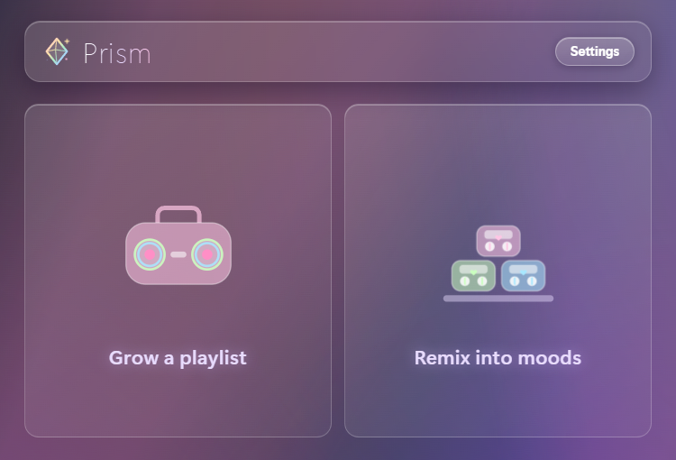
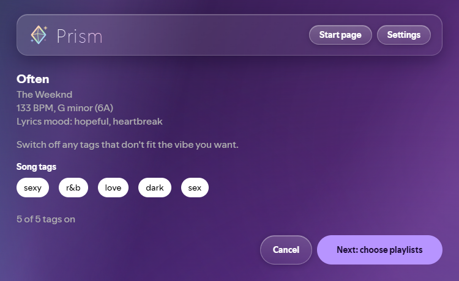
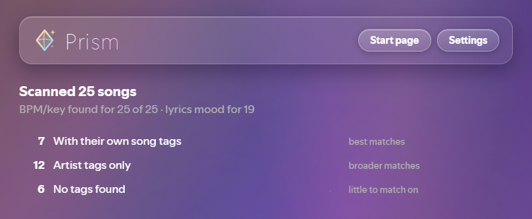
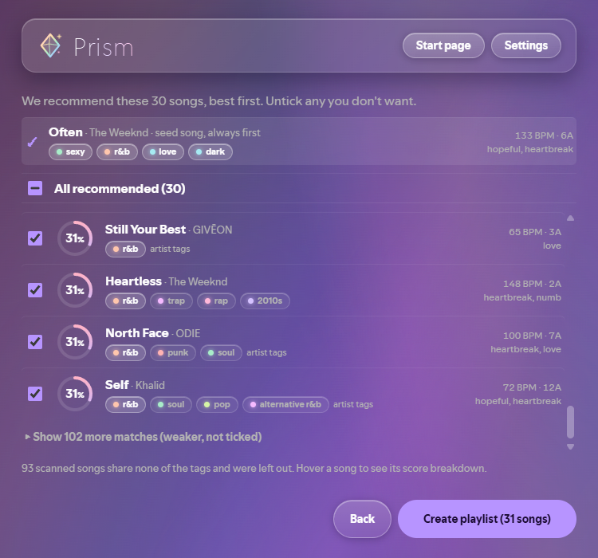
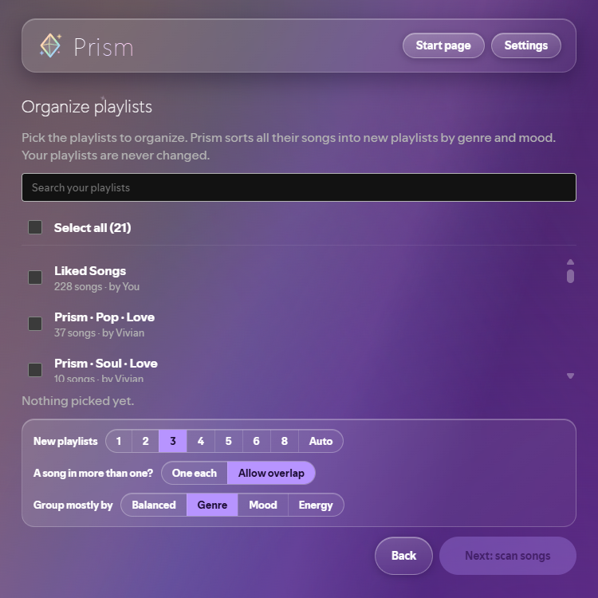
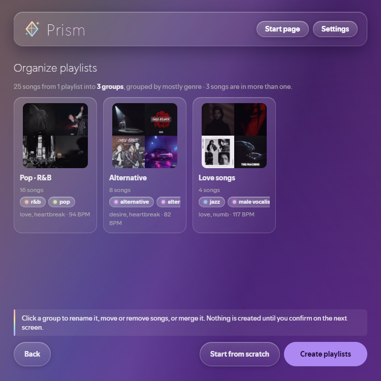
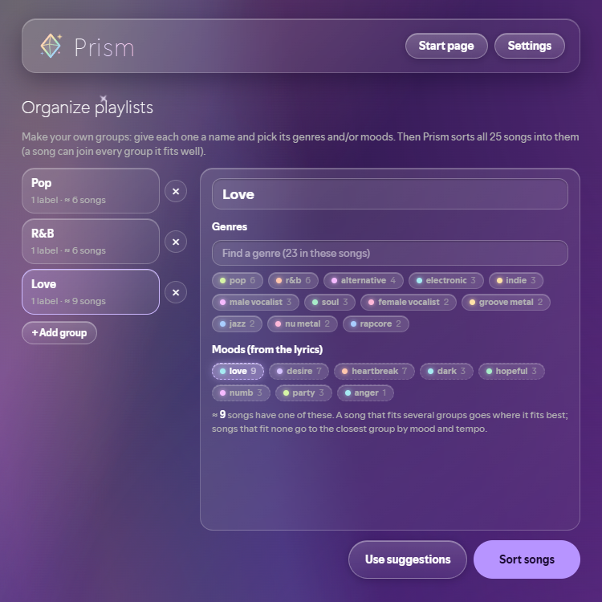
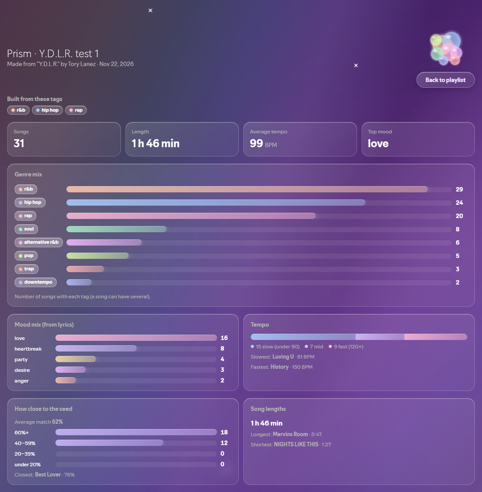
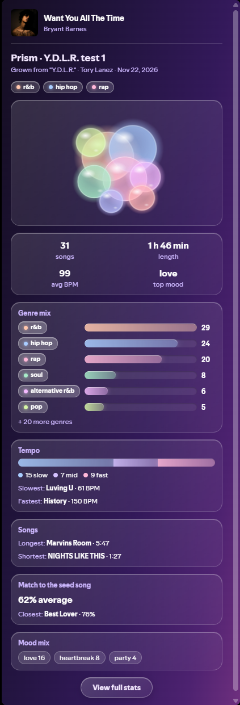
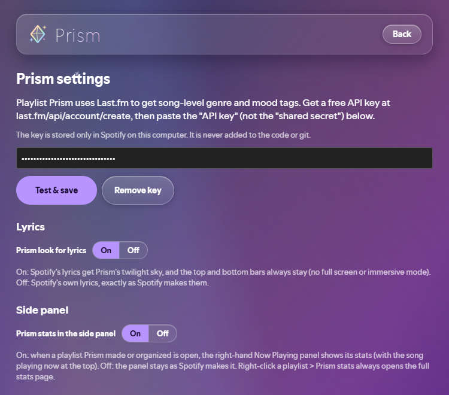

# Prism

**Grow and remix Spotify playlists from songs you already love.**

Prism is a [Spicetify](https://spicetify.app) custom app for the Spotify desktop client. It looks at
each song's genre tags (from Last.fm), tempo and musical key (from Spotify), and the mood of its
lyrics. With that it can:

- **Grow a playlist** around the feel of one song, or
- **Remix your playlists** into new ones sorted by genre and mood.

Prism only uses songs from playlists you pick. It never adds random songs from Spotify's catalogue,
and it **never changes your existing playlists**. Every playlist it makes is a new one.

<p align="center">
  
</p>

---

## Contents

- [Grow a playlist](#grow-a-playlist)
- [Remix into moods](#remix-into-moods)
- [Playlist stats](#playlist-stats)
- [Stats in the side panel](#stats-in-the-side-panel)
- [Prism look for lyrics](#prism-look-for-lyrics)
- [Settings](#settings)
- [How songs are matched](#how-songs-are-matched)
- [Your playlists are safe](#your-playlists-are-safe)
- [Install](#install)
- [Development](#development)

---

## Grow a playlist

Start from one favourite song and grow a playlist of songs that feel like it.

### 1. Pick a seed song

Right-click any song in Spotify and choose **Start a Prism playlist**. You can also start from the
song that's playing or paste a song link on the start page.

Prism shows the song's tempo, key, lyrics mood and its genre tags. Switch off any tag that doesn't
fit the vibe you want.

<p align="center">
  
</p>

### 2. Choose where songs can come from

Pick any of your playlists and/or Liked Songs. Only songs in these are considered. A song that's in
several playlists is counted once.

### 3. Scan

Prism looks up every song's tags, tempo, key and lyrics mood. Results are cached, so the next scan
is much faster. The summary shows how many songs had their own tags and how many fell back to
their artist's tags.

<p align="center">
  
</p>

### 4. Review the matches

The best 30 matches are ticked for you, best first, with a score ring, the shared tags, BPM/key and
lyrics mood for each song. Hover a song to see why it scored what it did. Untick anything you don't
want, or open the weaker matches to add more.

<p align="center">
  
</p>

### 5. Create

Name the playlist and Prism creates it as a **new** playlist in your library.

---

## Remix into moods

Shuffle one or more playlists into fresh ones sorted by genre and mood. Make several, or just the
one you want.

### Set up

Pick the playlists to remix (same picker as above), then choose:

- **New playlists:** 1, 2, 3, 4, 5, 6, 8 or **Auto** (Prism picks the number that splits best)
- **A song in more than one?** One each, or allow overlap
- **Group mostly by:** Balanced, Genre, Mood (lyrics) or Energy (tempo)

<p align="center">
  
</p>

### Review the suggested groups

Prism groups the songs and names each group after its main tags. Each group is a card with an
album-art mosaic, song count, genre and mood labels, and tempo. Click a card to rename it, move or
remove songs, or combine it with another group.

<p align="center">
  
</p>

### …or start from scratch

Prefer to decide yourself? **Start from scratch** lets you make your own groups: give each one a
name and pick its genres and/or moods. Each label shows how many songs have it. Prism then sorts
every song into the group it fits best. Songs without tags go to the closest group by mood and
tempo.

<p align="center">
  
</p>

### Create

A final screen lists every playlist that will be made (optionally named "Prism · …") and creates
them one at a time.

---

## Playlist stats

Right-click any playlist and choose **Prism stats**. For playlists Prism made, the page shows:

- the seed song or source playlists, the date, and the tags it was built from
- songs, total length, average tempo and top mood
- **genre mix** as glass bars, and a **fingerprint** of glass bubbles (one per genre, pop them!)
- **mood mix** from the lyrics, **tempo** spread with the slowest and fastest songs
- **how close** each song is to the seed, and the longest and shortest songs
- **artists**, **eras** (songs per decade) and **key** (major vs minor, most common key)

For playlists Prism didn't make, it shows an estimate from what has already been scanned.

<p align="center">
  
</p>

## Stats in the side panel

When you open a playlist Prism made, Spotify's right-hand Now Playing panel shows its stats: the song
playing now, the playlist's tags, fingerprint bubbles, key numbers, top genres, tempo, mood and a
**View full stats** button.

<p align="center">
  
</p>

Prism playlists also get a soft purple highlight when you hover them in the sidebar.

## Prism look for lyrics

Spotify's lyrics view gets Prism's twilight sky instead of the album colours, and the top bar and
player controls always stay visible (no full screen or immersive mode hiding them). You can turn
this off in Settings to get Spotify's own lyrics back.

## Settings

- **Last.fm API key** (required): get a free one at
  [last.fm/api/account/create](https://www.last.fm/api/account/create). It's stored only in Spotify
  on your computer.
- **Prism look for lyrics:** on/off
- **Prism stats in the side panel:** on/off

<p align="center">
  
</p>

---

## How songs are matched

Each candidate song is compared with the seed on four signals:

| Signal | Weight | Where it comes from |
| --- | --- | --- |
| Genre and mood tags | 60 | Last.fm song tags. If a song has none, its artist's tags count for half. |
| Lyrics mood | 15 | Lyrics words sorted into 8 moods (love, heartbreak, desire, party…). English only. Only the mood profile is kept, never the lyrics. |
| Tempo (BPM) | 15 | Spotify |
| Musical key | 10 | Spotify (Camelot wheel) |

Tags are cleaned first. Only real genres (the MusicBrainz genre list plus a few extras) and mood
tags are kept, so personal labels like "my top songs" or "saw live" are dropped.

Remix groups songs with the same signals (genre tags weighted by how rare they are, lyrics mood and
tempo). Key is shown but not used for grouping. The same input always gives the same groups.

## Your playlists are safe

- Prism **never** adds to, removes from, reorders, renames or deletes an existing playlist or your
  Liked Songs.
- The only thing it writes is a **new** playlist, then songs into that new playlist.
- All write calls live in one file (`src/spotify/write.ts`), which checks that the target is a
  playlist created in the same session. A unit test fails if a write call appears anywhere else.
- New playlists usually come out **private**.

---

## Install

Prism isn't in the Spicetify Marketplace yet, so for now you build it from source.

Requirements: the Spotify desktop app, [Spicetify](https://spicetify.app/docs/getting-started),
[Node.js](https://nodejs.org) and a free [Last.fm API key](https://www.last.fm/api/account/create).

```powershell
git clone https://github.com/hellovvn/spicetify-prism.git
cd spicetify-prism
npm install
npm run build
spicetify config custom_apps playlist-prism
spicetify apply
```

Then open Spotify, click the Prism diamond in the top bar, open **Settings** and paste your Last.fm
API key.

## Development

```powershell
npm run watch          # rebuild on save
spicetify watch -a     # second terminal: reload Spotify when the app changes
npm test               # unit tests (Vitest)
```

Built with TypeScript, React and [Spicetify Creator](https://github.com/spicetify/spicetify-creator).

## License

MIT
