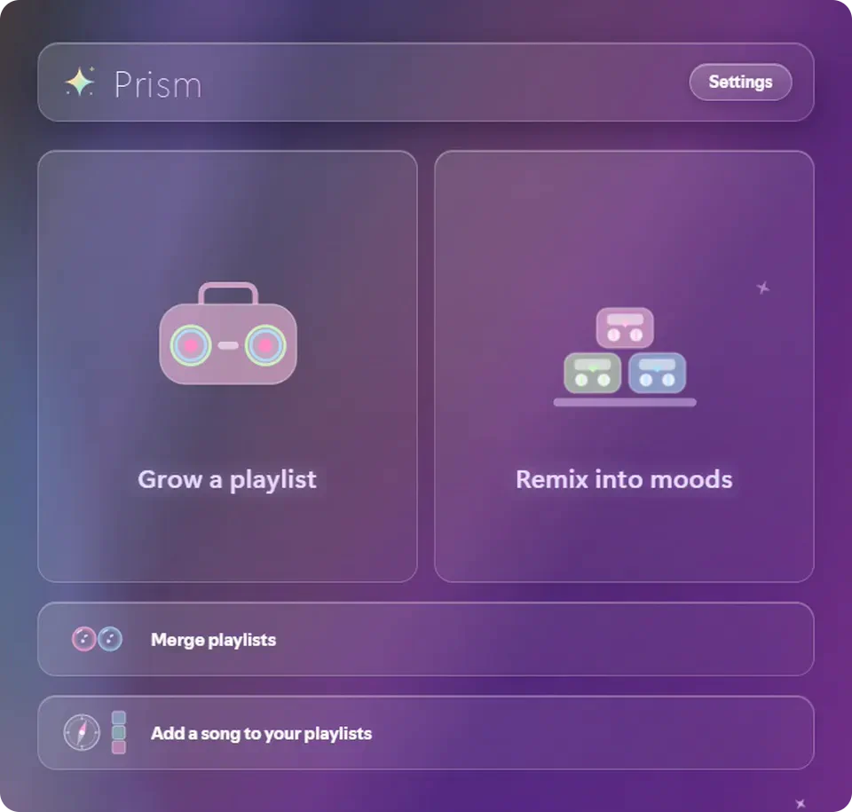
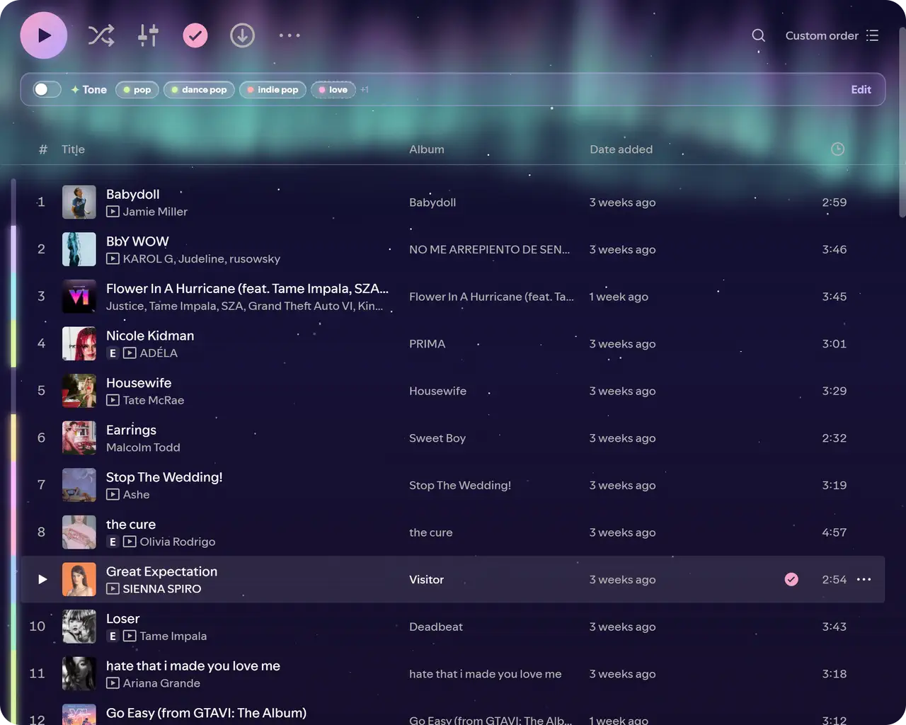
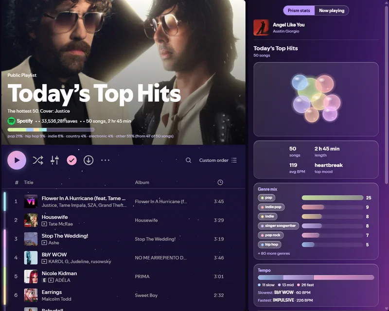
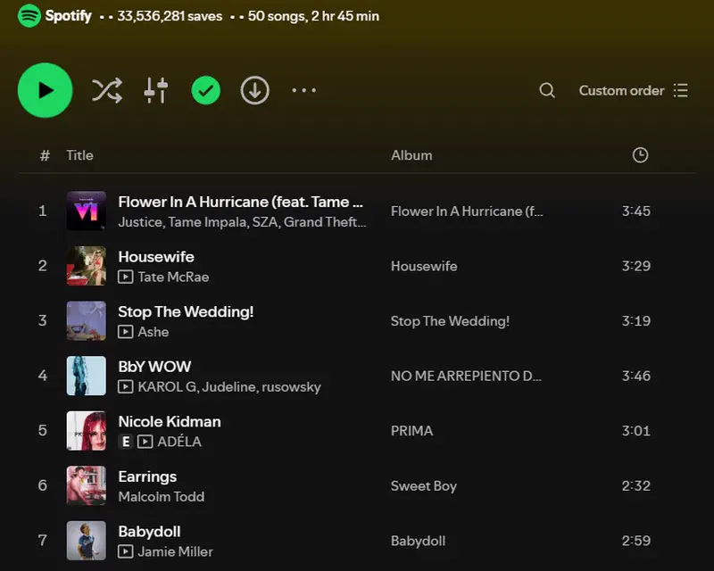

<p align="center">
  
</p>

<p align="center">
  <b>A Spotify companion that helps you get more out of the music you already have.</b><br>
  Grow a playlist from a favourite song, remix messy playlists into tidy ones,<br>
  see what each playlist is made of, and give Spotify a softer, twilight look.
</p>

<p align="center">
  
  
  
</p>

<p align="center">
  <a href="https://hellovvn.github.io/spicetify-prism/"><b>Read the guide</b></a> ·
  <a href="#install">Install</a> ·
  <a href="#support">Support</a>
</p>

<p align="center">
  
</p>

## Features

Click a card for the full guide to that feature.

<a href="https://hellovvn.github.io/spicetify-prism/grow.html"></a>

<p align="center"></p>

Right-click a song, pick the tags that fit, and Prism ranks songs from your own playlists, plus a few marked new finds. [Read the guide →](https://hellovvn.github.io/spicetify-prism/grow.html)

<a href="https://hellovvn.github.io/spicetify-prism/remix.html"></a>

<p align="center"></p>

Pick playlists and Prism sorts their songs into new ones by genre and mood, or by vibes you choose. [Read the guide →](https://hellovvn.github.io/spicetify-prism/remix.html)

<a href="https://hellovvn.github.io/spicetify-prism/merge.html"></a>

<p align="center"></p>

Pick two or more playlists and get one new playlist without the duplicates. [Read the guide →](https://hellovvn.github.io/spicetify-prism/merge.html)

<a href="https://hellovvn.github.io/spicetify-prism/add-with-prism.html"></a>

<p align="center"></p>

Right-click a song and see the five playlists of yours it fits best. [Read the guide →](https://hellovvn.github.io/spicetify-prism/add-with-prism.html)

<a href="https://hellovvn.github.io/spicetify-prism/tone.html"></a>

<p align="center"></p>

A score ring on every song shows how well it fits the playlist's vibe. [Read the guide →](https://hellovvn.github.io/spicetify-prism/tone.html)

<a href="https://hellovvn.github.io/spicetify-prism/stats.html"></a>

<p align="center"></p>

Genres, moods, tempo, artists, eras and key for any playlist. [Read the guide →](https://hellovvn.github.io/spicetify-prism/stats.html)

<a href="https://hellovvn.github.io/spicetify-prism/side-panel.html"></a>

<p align="center"></p>

The open playlist's stats in Spotify's right-hand panel while you listen. [Read the guide →](https://hellovvn.github.io/spicetify-prism/side-panel.html)

<a href="https://hellovvn.github.io/spicetify-prism/themes.html"></a>

<p align="center"></p>

Moving skies for Spotify, and a different one per playlist if you like. [Read the guide →](https://hellovvn.github.io/spicetify-prism/themes.html)

Prism judges every song on its own Last.fm tags, lyrics mood, tempo and key
([how songs are matched](https://hellovvn.github.io/spicetify-prism/how-it-works.html)). It only
writes to Spotify when you click a button that says so, and never deletes playlists or removes songs
([what Prism changes](https://hellovvn.github.io/spicetify-prism/what-prism-changes.html)).
Once a day it sends anonymous usage counts (which features were used, never your songs or names);
switch that off in Settings > Feedback ([privacy](https://hellovvn.github.io/spicetify-prism/what-prism-changes.html#privacy)).

**Every feature, step by step, with clips: [the Prism guide](https://hellovvn.github.io/spicetify-prism/).**

## Install

You need the Spotify desktop app and [Spicetify](https://spicetify.app/docs/getting-started).
No Last.fm account or key needed ([use your own key](https://hellovvn.github.io/spicetify-prism/lastfm-key.html) if you like). Tested on Windows; macOS and Linux should work
([report](https://github.com/hellovvn/spicetify-prism/issues) anything that breaks).

There are **two ways** to install Prism. Pick one:

### Option 1: one command (Windows)

Paste this into PowerShell. Run it again any time to update.

```powershell
iwr -useb https://raw.githubusercontent.com/hellovvn/spicetify-prism/main/install.ps1 | iex
```

### Option 2: by hand (any system)

The Marketplace can't install custom apps itself, so:

1. Download `prism-<version>.zip` from the [latest release](https://github.com/hellovvn/spicetify-prism/releases/latest).
2. Unzip it into Spicetify's `CustomApps` folder, so you end up with `CustomApps/prism`
   (Windows: `%APPDATA%\spicetify\CustomApps`, macOS / Linux: `~/.config/spicetify/CustomApps`).
3. Turn it on:

   ```powershell
   spicetify config custom_apps prism
   spicetify apply
   ```

Need more help? The [full install guide](https://hellovvn.github.io/spicetify-prism/install.html) explains:

- how to update Prism to a new version
- what to do if Prism disappears after Spotify updates itself
- how to build Prism from its code (for developers)

## Support

Prism is free. If it makes your playlists nicer, you can buy me a coffee (also from
**Settings > About > Support Prism** inside the app).

<a href="https://ko-fi.com/hellovvn"></a>

## Credits and license

Genre and mood tags and similar songs come from [Last.fm](https://www.last.fm/) (powered by
AudioScrobbler). Tempo, key and lyrics come from Spotify. Prism isn't made by or connected to
Last.fm or Spotify. Developing Prism: [development guide](https://hellovvn.github.io/spicetify-prism/development.html).

[MIT](LICENSE)
