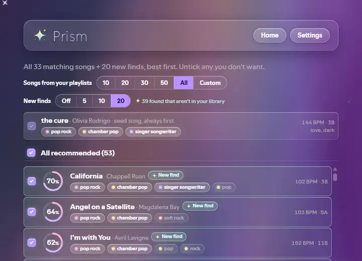
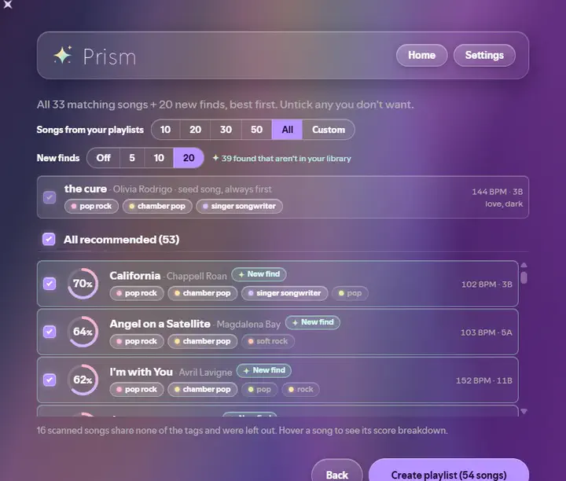
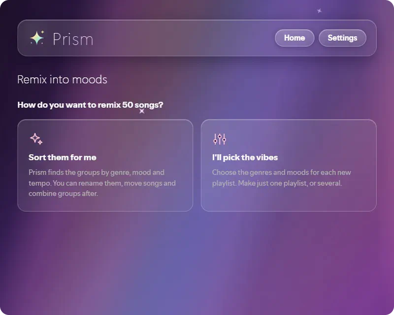
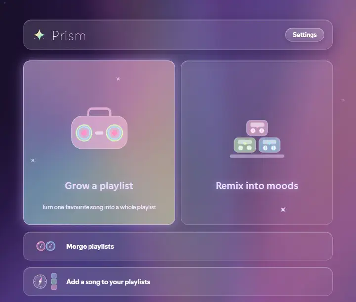
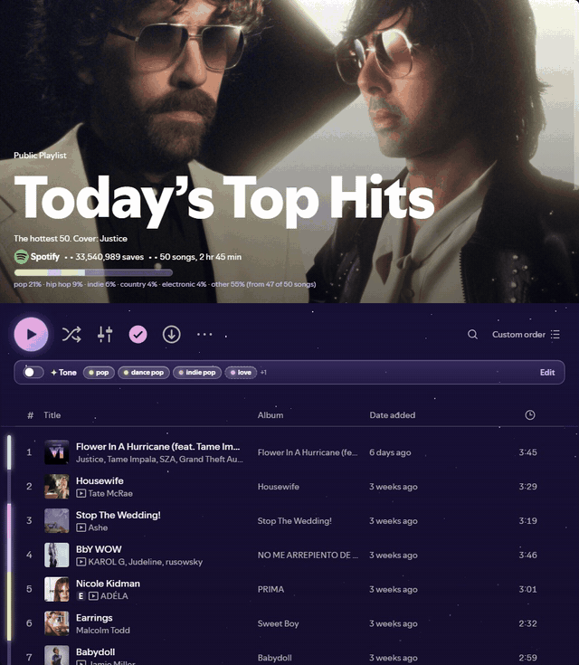
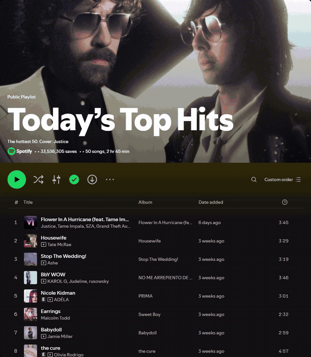
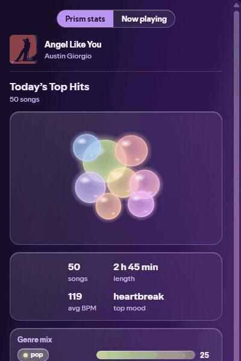

<p align="center">
  
</p>

<p align="center">
  <b>A Spotify companion that helps you get more out of the music you already have.</b><br>
  Grow a playlist from a favourite song, remix messy playlists into tidy ones,<br>
  see what each playlist is made of, and give Spotify a softer, twilight look.
</p>

<p align="center">
  
  
  
  
</p>

<p align="center">
  <a href="#features">Features</a> ·
  <a href="#install">Install</a> ·
  <a href="#how-songs-are-matched">How it works</a> ·
  <a href="#what-prism-changes">What Prism changes</a> ·
  <a href="#development">Development</a>
</p>

<p align="center">
  
</p>

---

## Features

<table>
  <tr>
    <td width="33%" valign="top">
      <br>
      <b><a href="#grow-a-playlist">Grow a playlist</a></b><br>
      Start with one song you love and get a playlist of songs that feel like it.
    </td>
    <td width="33%" valign="top">
      <br>
      <b><a href="#remix-into-moods">Remix into moods</a></b><br>
      Shuffle your playlists into fresh ones sorted by genre and mood.
    </td>
    <td width="33%" valign="top">
      <br>
      <b><a href="#merge-playlists">Merge playlists</a></b><br>
      Stack playlists together and drop the doubles.
    </td>
  </tr>
  <tr>
    <td valign="top">
      <br>
      <b><a href="#add-with-prism">Add with Prism</a></b><br>
      Let Prism find the best home for a song.
    </td>
    <td valign="top">
      <br>
      <b><a href="#playlist-tone">Playlist tone</a></b><br>
      Give a playlist a vibe and see which songs fit it and which drift.
    </td>
    <td valign="top">
      <br>
      <b><a href="#playlist-themes">Playlist themes</a></b><br>
      Nine moving skies across Spotify, and a different one per playlist.
    </td>
  </tr>
  <tr>
    <td valign="top">
      <br>
      <b><a href="#playlist-stats">Playlist stats</a></b><br>
      Genre mix, moods, tempo, eras and a bubble fingerprint.
    </td>
    <td valign="top">
      <br>
      <b><a href="#playlist-stats">Side panel stats</a></b><br>
      A playlist's stats right next to it while you listen.
    </td>
    <td valign="top">
      <b><a href="#prism-look-for-lyrics">Prism look for lyrics</a></b><br>
      Sing along under a twilight sky, with the controls always there.
    </td>
  </tr>
</table>

---

## Grow a playlist

1. Right-click any song and choose **Start a Prism playlist**, or start from the song that's
   playing or a pasted link.
2. Prism shows the song's genre tags, tempo, key and lyrics mood. Switch off any tag that doesn't fit.
3. Pick where songs can come from: any of your playlists and/or Liked Songs.
4. Prism scans them and ranks every song, with a score ring, the shared tags and the reasons it matched.
   Choose how many to keep (10, 20, 30, 50, All or your own number).
5. **New finds** (optional: Off, 5, 10 or 20): similar songs you don't have yet, from Last.fm. They're
   clearly marked and only ever go into the new playlist.
6. Click **Create**. The seed song comes first, the rest is shuffled, and the playlist starts with a
   [tone](#playlist-tone) based on what you picked.

## Remix into moods

Pick one or more playlists, then choose a door:

- **Sort them for me:** Prism suggests groups by genre, mood and tempo and names them.
- **I'll pick the vibes:** you choose the genres and moods for each group, and Prism sorts the songs in.

Each group is a card with an album-art mosaic. Rename it, move or remove songs, or combine groups.
Under **More options**: how many groups (Auto, 2–8), what to group by (Balanced, Genre, Mood, Energy)
and whether a song may land in more than one group. Songs that fit nowhere wait on a "Not included"
card, with the reason for each. **Create playlists** makes one new playlist per group.

## Merge playlists

Pick two or more playlists. Prism shows how many songs each has, the total, and how many duplicates
it drops (the same song, even from a different album). **Show duplicates** lists each one and which
copy was kept. Name the new playlist and click **Merge**. If you leave **Rename the originals** on,
your own originals get "[merged] " in front of their name, so you can tell them apart.

## Add with Prism

Right-click a song (or the song playing in the player bar) and open **Add with Prism**. Prism shows
the five playlists it fits best, judged on genre, lyrics mood, tempo and key. Click one to add the
song at the end. **More on the Prism page…** shows the scores and the shared genres. Only playlists
you can add to are suggested, and never ones that already have the song.

## Playlist tone

Right-click a playlist and choose **Add Prism tone**. Pick its key genres, lyrics moods and tempo
(Prism suggests a start from the songs already in it). A **Tone** strip appears on the playlist page.
Switch it on and every song gets a score ring for how well it fits, so the drifters stand out. Tones
are saved only on your computer.

## Playlist themes

In Settings, pick one of nine themes: **Twilight**, **Northern lights**, **Starry night**,
**Milky Way**, **Bubble nebula**, **Afterglow**, **Misty morning**, **Blossom canopy** or
**Window rain**. Playlist pages get a moving sky, a colour rail beside the songs (each song's main
genre) and a genre mix bar. Albums, artists, Liked Songs, Home, Search and the other pages get the
same sky or a quiet dark purple. Spotify's green turns pastel, and its bars, side panel, menus,
dialogs and pop-up messages become frosted glass.

Want one playlist to look different? Right-click it and choose **Prism theme** to give it its own
sky. That's saved only on your computer and never changes the playlist.

## Playlist stats

Right-click any playlist and choose **Prism stats**. The page shows songs, length, average tempo,
top mood and tone fit, the **genre mix** as glass bars, a **fingerprint** of glass bubbles (pop
them), mood mix, tempo spread, artists, eras and key. For playlists Prism made, it also shows the
seed song or the source playlists and how close each song is to the seed. Other playlists get an
estimate from what's already been scanned.

When any playlist is open, Spotify's right-hand panel gets a **Prism stats** tab next to
**Now playing**, with a compact version of the same stats and a **View full stats** button. For
playlists Prism didn't make, it fills in the songs it hasn't scanned yet while you look.

## Prism look for lyrics

Spotify's lyrics view gets Prism's sky (your theme's, or twilight with no theme) instead of the
album colours, and the top bar and player controls stay visible. Turn it off in Settings to get
Spotify's own lyrics back.

---

## How songs are matched

Prism judges every song on its own signals, not on its artist's genres:

| Signal | Weight | Where it comes from |
| --- | --- | --- |
| Genre and mood tags | 60 | Last.fm song tags. Songs without any use their artist's tags at half weight. |
| Lyrics mood | 15 | Lyrics words sorted into 8 moods (love, heartbreak, desire, party…). English only. |
| Tempo (BPM) | 15 | Spotify |
| Musical key | 10 | Spotify (Camelot wheel) |

Tags are cleaned first: only real genres (the MusicBrainz genre list plus a few extras) and mood
tags are kept, so personal labels like "my top songs" or "saw live" are dropped. Remix groups songs
with the same signals (rare genres count more than everywhere ones like "pop"), and the same input
always gives the same groups.

## What Prism changes

Prism only writes to Spotify when you click a button that says so:

| You click | What happens |
| --- | --- |
| **Create** (Grow, Remix) | A **new** playlist is made and filled. |
| **Merge** | A **new** playlist is made. If "Rename the originals" is on, your own originals get "[merged] " in front of their name. Their songs, order, cover and description are never touched. |
| **Add with Prism** | One song is added to the end of the playlist you picked. |

Prism never deletes playlists and never removes or reorders songs. Tones, themes, stats and settings
are stored only on your computer. All write calls live in one file (`src/spotify/write.ts`), and a
unit test fails if one shows up anywhere else.

**Privacy:** your Last.fm API key is stored only in Spotify on your computer. Song titles and
artists are sent to Last.fm to look up tags and similar songs. Lyrics are read to work out a mood
profile, and the lyrics themselves are never stored.

---

## Install

Prism isn't in the Spicetify Marketplace yet, so for now you build it from source.

You need: the Spotify desktop app, [Spicetify](https://spicetify.app/docs/getting-started),
[Node.js](https://nodejs.org) and a free [Last.fm API key](https://www.last.fm/api/account/create).

```powershell
git clone https://github.com/hellovvn/spicetify-prism.git
cd spicetify-prism
npm install
npm run build
spicetify config custom_apps playlist-prism
spicetify apply
```

Then open Spotify, click the Prism star in the top bar, open **Settings** and paste your Last.fm
API key.

### Settings

Open them from the Prism page, or from Spotify's profile menu > **Prism settings**.

- **Last.fm API key** (required)
- **Playlist theme:** No theme or one of the nine skies
- **Prism look for lyrics:** on or off
- **Prism stats in the side panel:** on or off

## Development

```powershell
npm run watch          # rebuild on save
spicetify watch -a     # second terminal: reload Spotify when the app changes
npm test               # unit tests (Vitest)
```

Built with TypeScript, React and [Spicetify Creator](https://github.com/spicetify/spicetify-creator).
How the demo GIFs are made: [docs/media/SHOTLIST.md](docs/media/SHOTLIST.md).

## License

MIT
