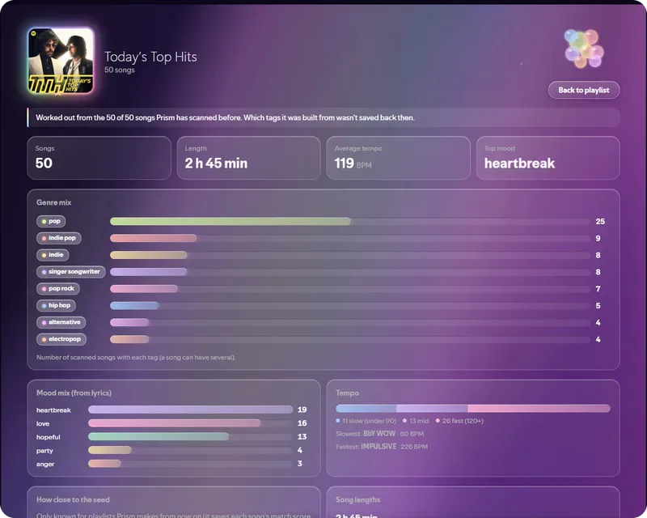

<p align="center">
  
</p>

<p align="center">
  <b>A Spotify companion that helps you get more out of the music you already have.</b><br>
  Grow a playlist from a favourite song, remix messy playlists into tidy ones,<br>
  see what each playlist is made of, and give Spotify a softer, twilight look.
</p>

<p align="center">
  
  
  
</p>

<p align="center">
  <a href="#features">Features</a> ·
  <a href="#install">Install</a> ·
  <a href="#how-songs-are-matched">How it works</a> ·
  <a href="#what-prism-changes">What Prism changes</a> ·
  <a href="#development">Development</a> ·
  <a href="#support">Support</a>
</p>

<p align="center">
  
</p>

## Features

<table>
<tr>
<td width="50%" valign="middle">

</td>
<td width="50%" valign="middle">
<h3 id="grow-a-playlist">Grow a playlist</h3>
<p><b>Start with one song you love and get a playlist of songs that feel like it.</b></p>
<ul>
<li>Right-click a song, then <b>Start a Prism playlist</b></li>
<li>Matches come from your own playlists and Liked Songs</li>
<li>Optional <b>New finds</b>: similar songs you don't have yet</li>
</ul>
<details><summary>Step by step</summary>

1. Right-click any song and choose **Start a Prism playlist**, or start from the song that's playing or a pasted link.
2. Prism shows the song's genre tags, tempo, key and lyrics mood. Switch off any tag that doesn't fit.
3. Pick where songs can come from: any of your playlists and/or Liked Songs.
4. Prism ranks every song with a score ring, the shared tags and why it matched. Keep 10, 20, 30, 50, all or your own number.
5. **New finds** (Off, 5, 10 or 20): similar songs from Last.fm that aren't in your library. They're marked and only go into the new playlist.
6. Click **Create**. The seed song comes first, the rest is shuffled.

</details>
</td>
</tr>
<tr>
<td width="50%" valign="middle">
<h3 id="remix-into-moods">Remix into moods</h3>
<p><b>Shuffle your playlists into fresh ones sorted by genre and mood.</b></p>
<ul>
<li><b>Sort them for me</b>, or <b>I'll pick the vibes</b></li>
<li>Each group is a card with an album-art mosaic</li>
<li>Rename, move songs, combine groups, then create</li>
</ul>
<details><summary>Step by step</summary>

Pick one or more playlists, then choose a door:

- **Sort them for me:** Prism suggests groups by genre, mood and tempo and names them.
- **I'll pick the vibes:** you choose the genres and moods for each group, and Prism sorts the songs in.

Under **More options**: how many groups (Auto, 2–8), what to group by (Balanced, Genre, Mood, Energy) and whether a song may land in more than one group. Songs that fit nowhere wait on a "Not included" card, with the reason for each. **Create playlists** makes one new playlist per group.

</details>
</td>
<td width="50%" valign="middle">

</td>
</tr>
<tr>
<td width="50%" valign="middle">

</td>
<td width="50%" valign="middle">
<h3 id="merge-playlists">Merge playlists</h3>
<p><b>Stack your playlists together and drop the doubles.</b></p>
<ul>
<li>Pick two or more playlists</li>
<li>The same song from another album counts as a double too</li>
<li><b>Show duplicates</b> lists every copy left out</li>
</ul>
<details><summary>Step by step</summary>

Prism shows how many songs each playlist has, the total, and how many duplicates it drops. Name the new playlist and click **Merge**. If you leave **Rename the originals** on, your own originals get "[merged] " in front of their name, so you can tell them apart. Their songs, order, cover and description stay as they are.

</details>
</td>
</tr>
<tr>
<td width="50%" valign="middle">
<h3 id="add-with-prism">Add with Prism</h3>
<p><b>Let Prism find the best home for a song.</b></p>
<ul>
<li>Right-click a song, then <b>Add with Prism</b></li>
<li>See the five playlists it fits best</li>
<li>One click adds it to the end</li>
</ul>
<details><summary>Step by step</summary>

Works on any song, including the one playing in the player bar. Playlists are judged on genre, lyrics mood, tempo and key. **More on the Prism page…** shows the scores and the shared genres. Only playlists you can add to are suggested, and never ones that already have the song.

</details>
</td>
<td width="50%" valign="middle">

</td>
</tr>
<tr>
<td width="50%" valign="middle">

</td>
<td width="50%" valign="middle">
<h3 id="playlist-tone">Playlist tone</h3>
<p><b>Give a playlist a vibe and see which songs fit it and which drift.</b></p>
<ul>
<li>Right-click a playlist, then <b>Add Prism tone</b></li>
<li>Pick its key genres, moods and tempo</li>
<li>A score ring on every song makes the drifters stand out</li>
</ul>
<details><summary>Step by step</summary>

Prism suggests a start from the songs already in the playlist. A **Tone** strip appears on the playlist page; switch it on to see the rings. Playlists you grow with Prism start with a tone. Tones are saved only on your computer.

</details>
</td>
</tr>
<tr>
<td width="50%" valign="middle">
<h3 id="playlist-stats">Playlist stats</h3>
<p><b>See what any playlist is made of.</b></p>
<ul>
<li>Right-click a playlist, then <b>Prism stats</b></li>
<li>Genre mix, moods, tempo, artists, eras and key</li>
<li>A fingerprint of glass bubbles (pop them)</li>
</ul>
<details><summary>Step by step</summary>

The page shows songs, length, average tempo, top mood and tone fit, the **genre mix** as glass bars, mood mix, tempo spread, artists, eras and key. For playlists Prism made, it also shows the seed song or source playlists and how close each song is to the seed. Other playlists get an estimate from what's already been scanned.

</details>
</td>
<td width="50%" valign="middle">

</td>
</tr>
<tr>
<td width="50%" valign="middle">

</td>
<td width="50%" valign="middle">
<h3 id="side-panel-stats">Stats beside your music</h3>
<p><b>A playlist's stats right next to it while you listen.</b></p>
<ul>
<li>A <b>Prism stats</b> tab next to <b>Now playing</b></li>
<li>Fills in songs it hasn't scanned yet while you look</li>
<li><b>View full stats</b> opens the whole page</li>
</ul>
<details><summary>Step by step</summary>

Shows on every playlist you open. Turn it off in Settings with **Prism stats in the side panel**.

</details>
</td>
</tr>
<tr>
<td width="50%" valign="middle">
<h3 id="playlist-themes">Playlist themes</h3>
<p><b>Nine moving skies across Spotify, and a different one per playlist.</b></p>
<ul>
<li>Pick a theme in Settings</li>
<li>Spotify's green turns pastel, its bars turn to frosted glass</li>
<li>Lyrics get the sky too, with the controls always there</li>
</ul>
<details><summary>Step by step</summary>

Themes: **Twilight**, **Northern lights**, **Starry night**, **Milky Way**, **Bubble nebula**, **Afterglow**, **Misty morning**, **Blossom canopy** and **Window rain**. Playlist pages get a moving sky, a colour rail beside the songs (each song's main genre) and a genre mix bar. Albums, artists, Liked Songs, Home, Search and the other pages get the same sky or a quiet dark purple.

Want one playlist to look different? Right-click it and choose **Prism theme**. That's saved only on your computer and never changes the playlist.

</details>
</td>
<td width="50%" valign="middle">

</td>
</tr>
</table>

---

## How songs are matched

Prism judges every song on its own signals, not on its artist's genres:

| Signal | Weight | Where it comes from |
| --- | --- | --- |
| Genre and mood tags | 60 | Last.fm song tags. Songs without any use their artist's tags at half weight. |
| Lyrics mood | 15 | Lyrics words sorted into 8 moods (love, heartbreak, desire, party…). English only. |
| Tempo (BPM) | 15 | Spotify |
| Musical key | 10 | Spotify (Camelot wheel) |

Tags are cleaned first: only real genres (the MusicBrainz genre list plus a few extras) and mood
tags are kept, so personal labels like "my top songs" or "saw live" are dropped. Remix groups songs
with the same signals (rare genres count more than everywhere ones like "pop"), and the same input
always gives the same groups.

## What Prism changes

Prism only writes to Spotify when you click a button that says so:

| You click | What happens |
| --- | --- |
| **Create** (Grow, Remix) | A **new** playlist is made and filled. |
| **Merge** | A **new** playlist is made. If "Rename the originals" is on, your own originals get "[merged] " in front of their name. Their songs, order, cover and description are never touched. |
| **Add with Prism** | One song is added to the end of the playlist you picked. |

Prism never deletes playlists and never removes or reorders songs. Tones, themes, stats and settings
are stored only on your computer. All write calls live in one file (`src/spotify/write.ts`), and a
unit test fails if one shows up anywhere else.

**Privacy:** if you add your own Last.fm API key, it is stored only in Spotify on your computer.
Without one, Prism asks its small relay for Prism's shared Last.fm key once per Spotify start. The relay counts
how many different people ask each day, so the developer knows roughly how many people use Prism: your
IP address is never stored (only a scrambled version for 2 days, so you're counted once a day), and
only the daily total is kept. Song titles and
artists are sent to Last.fm to look up tags and similar songs. Lyrics are read to work out a mood
profile, and the lyrics themselves are never stored.

---

## Install

You need: the Spotify desktop app and [Spicetify](https://spicetify.app/docs/getting-started).
No Last.fm account is needed: Prism comes with a shared Last.fm key.

Tested on Windows (Spicetify 2.46). macOS and Linux should work but haven't been tried yet:
please [report](https://github.com/hellovvn/spicetify-prism/issues) anything that breaks.

**Windows, one step:** paste this into PowerShell.

```powershell
iwr -useb https://raw.githubusercontent.com/hellovvn/spicetify-prism/main/install.ps1 | iex
```

It downloads the latest release into Spicetify's `CustomApps` folder and turns Prism on
([read the script](install.ps1) first if you like). Run it again any time to update.

**By hand (any system):** Prism is a Spicetify **custom app**. You'll find it in the Spicetify
Marketplace, but the Marketplace can't install custom apps itself, so it takes three steps:

1. Download `prism-<version>.zip` from the [latest release](https://github.com/hellovvn/spicetify-prism/releases/latest).
2. Unzip it into Spicetify's `CustomApps` folder, so you end up with `CustomApps/prism`.
   - Windows: `%APPDATA%\spicetify\CustomApps`
   - macOS / Linux: `~/.config/spicetify/CustomApps`

   (Not sure? `spicetify -c` shows Spicetify's config file; `CustomApps` is next to it.)
3. Turn it on:

   ```powershell
   spicetify config custom_apps prism
   spicetify apply
   ```

Then open Spotify and click the Prism star in the top bar. That's it: Prism comes with a shared
Last.fm key. Adding your own key is optional ([how to get one](#getting-a-lastfm-api-key)).

**Updating:** run the PowerShell line again, or download the new zip, replace the `prism`
folder, and run `spicetify apply`. Your settings, tones and stats stay (they're saved in Spotify, not in the folder).

**After a Spotify update** Spicetify may be switched off: run `spicetify restore backup apply`
and Prism comes back.

### From source

Needs [Node.js](https://nodejs.org) too. This build includes the developer tools (a debug hook for
the smoke test); `npm run release` makes the same clean zip as the releases.

```powershell
git clone https://github.com/hellovvn/spicetify-prism.git
cd spicetify-prism
npm install
npm run build
spicetify config custom_apps prism
spicetify apply
```

### Getting a Last.fm API key

Prism reads genre and mood tags and similar songs from Last.fm. Out of the box it uses Prism's
shared Last.fm key, so you don't need one. Your own free key is optional: handy if the shared one is
ever busy. It takes about a minute:

1. Sign in to [Last.fm](https://www.last.fm/login) (or [make a free account](https://www.last.fm/join)).
2. Open [last.fm/api/account/create](https://www.last.fm/api/account/create) and fill in the form:
   - **Contact email:** your email
   - **Application name:** anything, for example `Prism`
   - **Application description**, **Callback URL** and **Application homepage:** can stay empty
3. Click **Submit**. The next page shows an **API key** and a **Shared secret**.
4. Copy the **API key** (the Shared secret isn't needed).
5. In Spotify, open Prism's **Settings** (the Settings button on the Prism page, or Spotify's
   profile menu > **Prism settings**), paste the key and click **Test & save**.

Lost the key? Your keys are listed at [last.fm/api/accounts](https://www.last.fm/api/accounts).
The key stays on your computer (in Spotify's local storage) and is never sent anywhere except
Last.fm. Last.fm's API is free for non-commercial use ([terms](https://www.last.fm/api/tos)).

**If Prism says something about your key:**

| Message | What to do |
| --- | --- |
| "Couldn't get Prism's shared Last.fm access" | Prism couldn't fetch its shared key (offline?): try again, or add your own key. |
| "Prism's shared Last.fm access isn't working right now" | Try again later, or add your own key (steps above). |
| "Last.fm doesn't accept your API key" | The key was mistyped, or the Shared secret was pasted instead: copy the API key again. |
| "Last.fm has suspended your API key" | Make a new key (step 2) and save it in Settings. |
| "Last.fm rate limit hit" | Too many requests at once: wait a minute and try again. |


### Settings

Open them from the Prism page, or from Spotify's profile menu > **Prism settings**.

- **Your own Last.fm API key** (optional; Prism's shared key is used without one)
- **Playlist theme:** No theme or one of the nine skies
- **Prism look for lyrics:** on or off
- **Prism stats in the side panel:** on or off

## Development

```powershell
npm run watch          # rebuild on save
spicetify watch -a     # second terminal: reload Spotify when the app changes
npm test               # unit tests (Vitest)
```

Built with TypeScript, React and [Spicetify Creator](https://github.com/spicetify/spicetify-creator).
How the demo clips are made: [docs/media/SHOTLIST.md](docs/media/SHOTLIST.md).

## Credits

Genre and mood tags and similar songs come from [Last.fm](https://www.last.fm/) (powered by
AudioScrobbler). Tempo, key and lyrics come from Spotify. Prism isn't made by or connected to
Last.fm or Spotify.

## Support

Prism is free. If it makes your playlists nicer, you can buy me a coffee (also from
**Settings > About > Support Prism** inside the app).

<a href="https://ko-fi.com/hellovvn"></a>

## License

[MIT](LICENSE)
